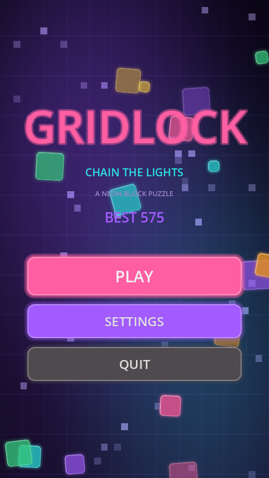
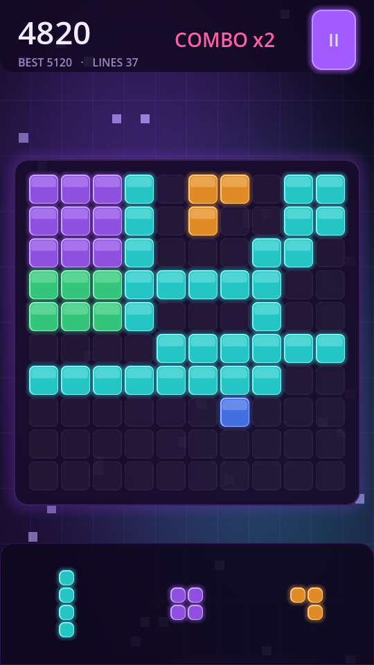
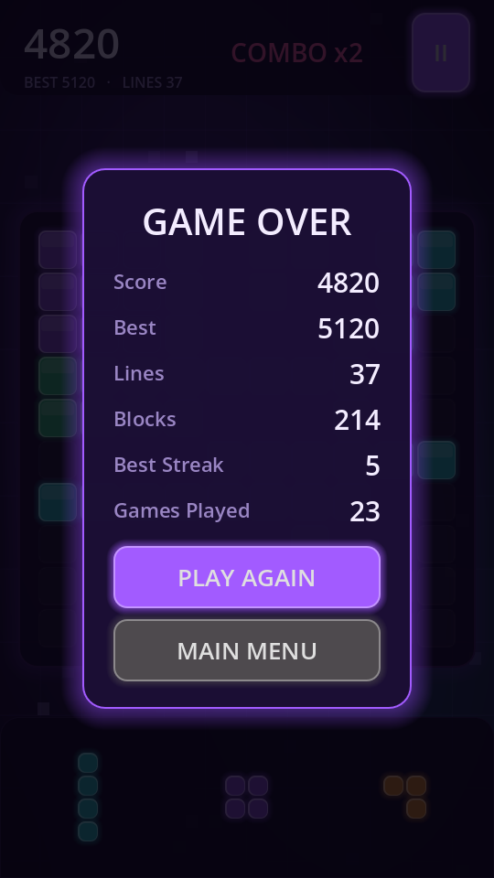
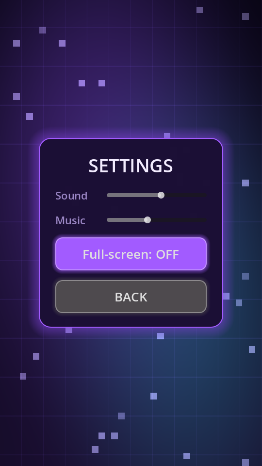

<div align="center">

# 🎮 GRIDLOCK

### Chain the Lights

**A polished, full-screen neon block puzzle for Godot 4.7.**

Drag three pieces onto a 10×10 board, complete rows and columns to clear them,
and chain clears for combo bonuses. The run ends when none of the remaining
pieces fit — *gridlock*.




</div>

> A love letter to the classic **1010!** formula, rebuilt from scratch with a
> smooth neon/glossy identity and *generated* art, music and sound. The game
> ships with no `.png`, `.wav` or font assets — every pixel is drawn from code
> and every sound is synthesized as 16-bit PCM at startup.

---

## ✨ Features

- **Smooth neon / glossy UI** built entirely from theme style boxes and a custom
  animated background shader — no bitmap art required.
- **"Almost" line hints** — any row or column one cell short of clearing pulses
  the board frame and pins the exact missing cell, so you can plan the chain.
- **Juicy clears** — a light beam sweeps each cleared line, tiles flash and pop,
  sparks burst, screen shake, floating score, and tiered **DOUBLE / TRIPLE /
  MEGA** banners.
- **Chain the lights** — clear on consecutive moves to grow a streak; a single
  clear can cascade into multi-line bonuses.
- **Procedural audio** — generated PCM tones *and* a soft chill-out music bed
  (a warm detuned pad, sub-bass and a drifting bell melody). Zero binary audio
  assets.
- **Lifetime stats** — games played, lines cleared and blocks placed persist and
  appear on the game-over card.
- **Full-screen by default** with a persistent toggle (`F11` or the settings
  screen), plus separate sound and music volume.
- **Deterministic, fully tested rules** with a weighted shuffle bag so piece
  droughts are rare.

## 📸 Screenshots

<div align="center">

| Gameplay | Game over | Settings |
|:---:|:---:|:---:|
|  |  |  |
| A mid-game board, glowing tray and HUD | Lifetime stats on the end-of-run card | Audio and display options |

</div>

## 🎯 How to Play

1. Pick up a piece from the tray at the bottom.
2. Drop it on empty cells. Glowing previews show whether the placement is legal
   (cyan = valid, red = invalid).
3. Fill an entire row or column to clear it and score. A pulsing frame and a
   pinned dot reveal lines that are **one cell** from clearing.
4. Clear multiple lines at once for a multiline bonus; clear on consecutive
   moves for a streak bonus.
5. The game ends when no remaining piece can be placed.

## 🏆 Scoring

| Rule | Value |
|------|-------|
| Points per line | `100` |
| Multiline bonus | `+0.5×` per extra line |
| Streak bonus | `+0.25×` per consecutive clearing move |

```text
score = 100 × lines × (1 + 0.5 × (lines − 1)) × (1 + 0.25 × (streak − 1))
```

A move that clears nothing resets the streak.

## 🎮 Controls

| Action | Input |
|--------|-------|
| Pick up / drop | Left mouse button (or touch) |
| Pause / resume | `Esc` or the ❚❚ button |
| Toggle full-screen | `F11` |

## 🚀 Getting Started

### Run from source

```bash
godot --path .                 # launches the main menu, full-screen
```

### Build a release binary

```bash
./build.sh                     # runs the tests, then exports the Linux release
./build.sh --windows           # cross-compile the Windows release (from Linux)
./build.sh --all               # both Linux and Windows
```

Options: `--linux`, `--windows`, `--all`, `--skip-tests`, `--debug`, `--clean`,
`--no-verify`, `--help`. The script verifies Godot and the matching export
templates are installed and writes the result to `build/`.

Windows builds are cross-compiled from Linux; the produced `.exe` is smoke
tested under `wine` (when installed) with `--no-verify` to skip that check.

### Run the built binary

```bash
./build/gridlock_x86_64_linux              # GNU/Linux
wine build/gridlock_x86_64_windows.exe     # Windows, via wine
```

Requires an OpenGL 3.3+ / Vulkan-capable GPU. On Windows, run
`build\gridlock_x86_64_windows.exe` directly.

## 🧪 Tests

```bash
./run_tests.sh
```

This runs two headless suites:

1. **`tests/test_runner.tscn`** — `105` assertions over `GameRules`,
   `PieceLibrary`, placement, clearing, scoring, streaks, near-complete hints
   and game-over detection.
2. **`tests/smoke_drag.tscn`** — `23` headless integration checks that boot the
   real game scene and drive a full drag from tray to board, verify hint
   refresh, then exercise the pause and game-over overlays.

That is **128 checks**, all exiting non-zero on failure.

## 🏗️ Architecture

Hard separation between **rules** and **presentation** — this is the single most
important convention in the repo.

```text
            input                       signals
   game/game.gd  ──►  Game (autoload)  ──►  game/game.gd
   (drag → placement)   .rules: GameRules     (draws + plays FX)
```

- **`GameRules`** (`scripts/core/game_rules.gd`, a `RefCounted`) owns the grid,
  tray, scoring, near-complete line hints and game-over detection. It emits
  signals (`score_changed`, `streak_changed`, `tray_changed`,
  `placement_resolved`) and knows nothing about nodes, input or rendering.
- **`Game`** (autoload, `scripts/autoload/game.gd`) holds the current
  `GameRules` plus the persisted best score and lifetime stats. UI talks to
  `Game`, never to disk.
- **`scripts/game/game.gd`** is the scene controller. It reads input, calls the
  rules, and renders the returned `result` Dictionary (beams, banners, sparks,
  hints). It holds no rules.

Because the rules are pure, they are fully unit-testable headlessly.

## 📁 Project Structure

```text
gridlock/
├── project.godot                    # Viewport, autoloads, full-screen config
├── export_presets.cfg               # Linux/X11 + Windows Desktop presets
├── build.sh                         # Release build script
├── run_tests.sh                     # Test runner
├── assets/shaders/background.gdshader
├── docs/screenshots/                # README images (excluded from exports)
├── scripts/
│   ├── core/                        # Pure, engine-light helpers
│   │   ├── game_constants.gd        # Single source of truth for tuning
│   │   ├── game_rules.gd            # ★ Authoritative rules (pure logic)
│   │   ├── piece.gd                 # A piece's shape + colour
│   │   ├── piece_library.gd         # Shape catalogue & weights
│   │   ├── piece_bag.gd             # Weighted shuffle-bag draw
│   │   ├── tone_factory.gd          # Runtime PCM tones + chill-out bed
│   │   ├── neon_style.gd            # Cached glossy StyleBoxes
│   │   ├── ui_kit.gd                # Themed widget factory
│   │   └── display_util.gd          # Full-screen persistence
│   ├── autoload/                    # Global services
│   │   ├── save_manager.gd          # ConfigFile persistence
│   │   ├── audio_manager.gd         # SFX pool + generated music loop
│   │   └── game.gd                  # Owns GameRules + best score + stats
│   ├── game/                        # Gameplay presentation
│   │   ├── board_cell.gd            # One visual tile (fill / preview / hint)
│   │   ├── board.gd                 # 10×10 field, hints, coordinate mapping
│   │   ├── piece_view.gd            # Tray / ghost tile grid
│   │   ├── tray.gd                  # Three-piece tray
│   │   └── game.gd                  # Scene controller (input + feedback)
│   └── ui/
│       ├── overlay.gd               # Reusable modal card
│       ├── main_menu.gd             # Animated title screen
│       └── settings.gd              # Audio + display settings
├── scenes/
│   ├── game.tscn
│   └── ui/{main_menu,settings}.tscn
├── tests/
│   ├── test_runner.gd / .tscn       # Pure GameRules unit tests
│   └── smoke_drag.gd / .tscn        # Headless integration test
└── build/                           # Generated artifacts (not source)
    ├── gridlock_x86_64_linux(.pck)
    └── gridlock_x86_64_windows(.exe, .pck)
```

## 🔧 Requirements

- **Godot 4.7+** (Forward Plus), or the bundled release binary.
- Linux/X11 for the export preset; the project itself is cross-platform.
- An OpenGL 3.3+ / Vulkan-capable GPU to run.

## 🙏 Credits

An original homage to the classic **1010!** block puzzle. Game design, code,
generated art and generated audio by the GRIDLOCK project.

## 📄 License

Released under the [MIT License](LICENSE).
